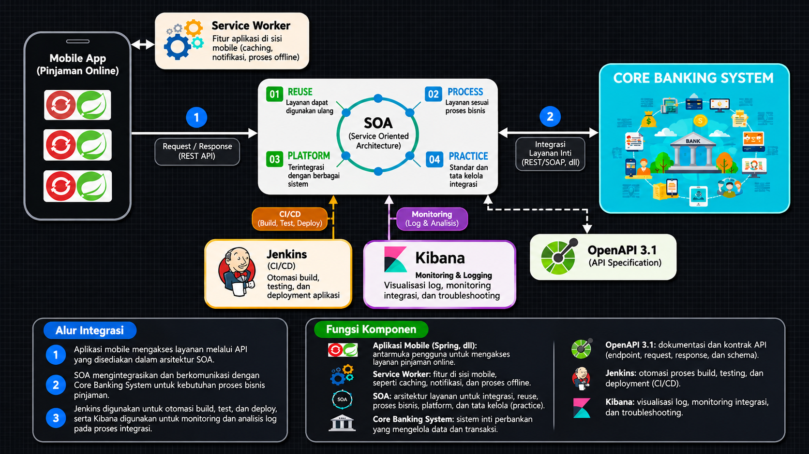

# Technical Test – Integration Analyst

**Nama:** Welly Wibowo  
**Posisi:** Integration Analyst

---

## Soal 1 – Deskripsi Diagram

### 1. Gambaran Umum

Diagram tersebut menggambarkan ekosistem teknologi untuk mendukung pengembangan aplikasi mobile fintech, khususnya aplikasi pinjaman online yang terintegrasi dengan Core Banking System.

Terdapat beberapa komponen teknologi yang memiliki fungsi masing-masing dalam mendukung proses pengembangan aplikasi, integrasi layanan, dokumentasi API, serta monitoring dan deployment.

### 2. Penjelasan Komponen

**A. Mobile Application**

Mobile Application merupakan aplikasi yang digunakan oleh pengguna untuk mengakses layanan pinjaman online. Aplikasi ini menjadi antarmuka utama bagi pengguna untuk melakukan aktivitas seperti pengajuan pinjaman dan melihat informasi terkait layanan.

**B. Service Worker**

Service Worker merupakan teknologi yang berjalan di sisi aplikasi dan dapat menangani proses tertentu di background. Contoh penggunaannya adalah caching, mendukung notifikasi, dan menyediakan kemampuan offline pada aplikasi.

**C. SOA (Service-Oriented Architecture)**

SOA merupakan pendekatan arsitektur yang memungkinkan berbagai layanan atau service berkomunikasi dan saling terintegrasi.

Pada diagram, SOA memiliki empat prinsip utama:

- **Reuse:** Layanan dapat digunakan kembali oleh sistem atau aplikasi lain.
- **Process:** Layanan mendukung kebutuhan dan proses bisnis.
- **Platform:** Memungkinkan integrasi dengan berbagai platform dan sistem.
- **Practice:** Menerapkan standar, praktik, serta tata kelola integrasi.

**D. Core Banking System**

Core Banking System merupakan sistem utama perbankan yang menangani operasional perbankan, seperti informasi rekening, saldo, dan transaksi keuangan.

Dalam konteks aplikasi pinjaman online, Core Banking System dapat diintegrasikan untuk mendukung proses bisnis yang berkaitan dengan layanan perbankan, seperti validasi informasi rekening dan pemrosesan transaksi sesuai kebutuhan.

**E. OpenAPI 3.1**

OpenAPI 3.1 merupakan spesifikasi standar untuk mendokumentasikan REST API. Dokumentasi ini mencakup endpoint, HTTP method, parameter, struktur request dan response, serta schema data.

Dengan adanya OpenAPI, developer dapat memahami kontrak API yang digunakan sehingga proses pengembangan dan integrasi antar-sistem menjadi lebih konsisten.

**F. Jenkins**

Jenkins merupakan automation server yang digunakan untuk mendukung proses Continuous Integration dan Continuous Delivery (CI/CD).

Jenkins dapat membantu mengotomatisasi proses build, automated testing, dan deployment aplikasi sehingga proses pengembangan serta rilis aplikasi menjadi lebih efisien.

**G. Kibana**

Kibana merupakan tools visualisasi dan analisis data yang dapat digunakan untuk memantau log aplikasi dan sistem.

Dalam proses integrasi, Kibana membantu tim melakukan monitoring, menelusuri error, menganalisis aktivitas sistem, serta melakukan troubleshooting ketika terjadi permasalahan.

### 3. Gambaran Alur Integrasi

Berdasarkan komponen yang ditampilkan, gambaran alur integrasi dapat dijelaskan sebagai berikut:

1. Pengguna mengakses layanan pinjaman online melalui Mobile Application.
2. Mobile Application berkomunikasi dengan layanan yang disediakan melalui API.
3. SOA berperan dalam mengatur komunikasi dan integrasi antar-layanan.
4. SOA melakukan integrasi dengan Core Banking System untuk mendukung kebutuhan proses bisnis perbankan.
5. OpenAPI 3.1 digunakan sebagai dokumentasi dan standar kontrak API.
6. Jenkins mendukung proses build, testing, dan deployment, sedangkan Kibana digunakan untuk monitoring serta analisis log.

### 4. Kesimpulan

Secara keseluruhan, diagram tersebut menggambarkan ekosistem teknologi yang mendukung pengembangan aplikasi fintech dan integrasinya dengan Core Banking System.

SOA berperan sebagai pendekatan arsitektur integrasi, OpenAPI 3.1 mendukung standardisasi dokumentasi API, Jenkins membantu otomatisasi proses deployment, dan Kibana mendukung monitoring serta troubleshooting.

Dengan penerapan komponen tersebut, proses integrasi antar-sistem diharapkan dapat berjalan secara lebih terstruktur, terukur, dan mudah dipelihara.

### 5. Diagram Arsitektur

Berikut merupakan visualisasi hubungan antar-komponen berdasarkan interpretasi terhadap diagram yang diberikan.



---

## Soal 2 – Rancangan Spesifikasi API

Sebagai implementasi dari standar **OpenAPI 3.1** pada diagram arsitektur, berikut adalah rancangan spesifikasi REST API untuk fitur inti pinjaman online, yaitu **Pengajuan Pinjaman Baru (*Submit Loan Application*)** yang menghubungkan aplikasi mobile dengan **Core Banking System**.

> File spesifikasi lengkap dalam format YAML dapat diakses pada repository ini di: [`specs/loan-application-openapi-3.1.yaml`](./specs/loan-application-openapi-3.1.yaml)

### 1. Informasi Umum Endpoint

- **Nama Fitur:** Pengajuan Pinjaman Baru (*Submit Loan Application*)
- **Base URL:** `https://api.ptxyz-fintech.co.id/api/v1`
- **Endpoint:** `/loans/applications`
- **HTTP Method:** `POST`
- **Format Data:** `application/json` (HTTPS / TLS 1.3)

### 2. Spesifikasi HTTP Headers

| Header | Tipe | Wajib | Contoh Nilai | Keterangan |
| :--- | :--- | :---: | :--- | :--- |
| `Authorization` | String | Ya | `Bearer eyJhbGciOiJIUzI1Ni...` | Token autentikasi nasabah (OAuth 2.0 / JWT). |
| `Content-Type` | String | Ya | `application/json` | Format *payload* pertukaran data. |
| `Idempotency-Key` | String (UUID) | Ya | `8f14e45f-ea9b-41a2-9c12-112233445566` | Mencegah duplikasi pengajuan/pencairan jika terjadi *retry* jaringan. |
| `X-Correlation-ID` | String (UUID) | Ya | `corr-9981-44ab-812c-77889900aabb` | ID pelacakan transaksi *end-to-end* untuk kebutuhan monitoring di Kibana. |
| `X-Signature` | String | Ya | `a94a8fe5ccb19ba61c4c0873d391e987...` | Validasi integritas *payload* menggunakan HMAC-SHA256. |

### 3. Request & Response Payload

**A. Contoh Request Body (`application/json`)**

```json
{
  "customerId": "CUST-20261123-00981",
  "loanDetails": {
    "productCode": "PINJOL-REG-01",
    "requestedAmount": 5000000,
    "currency": "IDR",
    "tenorMonths": 6,
    "interestRatePercent": 2.5,
    "loanPurpose": "MODAL_USAHA"
  },
  "disbursementAccount": {
    "bankCode": "008",
    "bankName": "Bank Mandiri",
    "accountNumber": "1330012345678",
    "accountHolderName": "WELLY WIBOWO"
  },
  "consent": {
    "tncAgreed": true,
    "tncVersion": "v2.4",
    "agreedTimestamp": "2026-11-23T08:45:00+07:00"
  }
}
```

**B. Contoh Response Sukses (`201 Created`)**

```json
{
  "status": "SUCCESS",
  "responseCode": "20100",
  "message": "Pengajuan pinjaman berhasil diproses",
  "correlationId": "corr-9981-44ab-812c-77889900aabb",
  "timestamp": "2026-11-23T08:45:02+07:00",
  "data": {
    "applicationId": "APP-20261123-77412",
    "coreLoanAccountNumber": "LN-88900112233",
    "applicationStatus": "APPROVED_FOR_DISBURSEMENT",
    "approvedAmount": 5000000,
    "adminFee": 150000,
    "netDisbursementAmount": 4850000,
    "monthlyInstallment": 958333,
    "firstDueDate": "2026-12-23"
  }
}
```

**C. Contoh Response Gagal Validasi Bisnis (`422 Unprocessable Entity`)**

```json
{
  "status": "FAILED",
  "responseCode": "42201",
  "message": "Nominal pengajuan melebihi sisa limit kredit nasabah",
  "correlationId": "corr-9981-44ab-812c-77889900aabb",
  "timestamp": "2026-11-23T08:45:01+07:00",
  "errors": [
    {
      "field": "loanDetails.requestedAmount",
      "reason": "Maksimal limit kredit yang tersedia saat ini adalah Rp 3.000.000"
    }
  ]
}
```

### 4. Standar Error Handling (HTTP Status Code)

| HTTP Status | Kode Internal | Kondisi Penanganan |
| :--- | :--- | :--- |
| `201 Created` | `20100` | Pengajuan berhasil diproses dan fasilitas pinjaman tercatat di Core Banking. |
| `400 Bad Request` | `40001` | Format JSON tidak valid atau parameter wajib tidak dikirim. |
| `401 Unauthorized` | `40100` | Token JWT tidak valid/kedaluwarsa atau `X-Signature` tidak cocok. |
| `409 Conflict` | `40901` | Duplikasi transaksi terdeteksi (`Idempotency-Key` sudah pernah diproses). |
| `422 Unprocessable Entity` | `42201` | Gagal validasi aturan bisnis (misal: limit kredit kurang atau skor kredit tidak memenuhi syarat). |
| `504 Gateway Timeout` | `50401` | Koneksi menuju Core Banking System mengalami *timeout*. |
